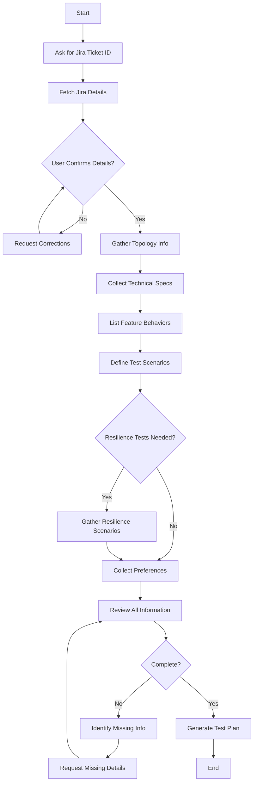

# Test Plan Generation Guidelines
## Extreme Networks EXOS Feature Test Plans

**Version**: 2.0  
**Date**: 2026-07-06  
**Purpose**: Comprehensive guide for generating production-quality EXOS Functional Test Plans (FTPs)

---

## 📚 Table of Contents

1. [**THE QA WORKFLOW** (CRITICAL - READ FIRST)](#the-qa-workflow)
2. [Key Learnings](#key-learnings)
3. [Official vs AI-Generated Comparison](#official-vs-ai-generated-comparison)
4. [QA-Style Information Gathering Questions](#qa-style-information-gathering-questions)
5. [Test Plan Structure Template](#test-plan-structure-template)
6. [Test Case Writing Best Practices](#test-case-writing-best-practices)
7. [Common Pitfalls to Avoid](#common-pitfalls-to-avoid)
8. [Quality Checklist](#quality-checklist)

---

## 🚨 THE QA WORKFLOW (CRITICAL - READ FIRST)

### **Proper Test Plan Generation Sequence**

**NEVER generate a test plan immediately!** Follow this systematic workflow:

```
┌──────────────────────────────────────────────────────────────────────┐
│                    1. SKILL FILE ANALYSIS                             │
│  ✓ Read skill-[JIRA].md file generated from Jira ticket             │
│  ✓ Understand feature description, test scenarios, business context  │
│  ✓ Identify key behaviors mentioned                                  │
└──────────────────────────────────────────────────────────────────────┘
                                    ↓
┌──────────────────────────────────────────────────────────────────────┐
│                    2. CODE COMMIT ANALYSIS                            │
│  ✓ Use commit analyzer to find implementation changes                │
│  ✓ Identify modified files (CLI handlers, API endpoints, configs)    │
│  ✓ Understand implementation architecture                            │
│  ✓ Find specific values used in code (VLANs, NSI, thresholds)       │
└──────────────────────────────────────────────────────────────────────┘
                                    ↓
┌──────────────────────────────────────────────────────────────────────┐
│                    3. GAP ANALYSIS                                    │
│  ✓ Compare skill file scenarios vs code implementation               │
│  ✓ Identify missing test scenarios                                   │
│  ✓ Find edge cases not mentioned in Jira                            │
│  ✓ Identify operational scenarios (HA, failover, reboot)            │
└──────────────────────────────────────────────────────────────────────┘
                                    ↓
┌──────────────────────────────────────────────────────────────────────┐
│       4. ASK QA-STYLE QUESTIONS (This was missing!)                  │
│  ✓ Think like a QA engineer, not a developer                         │
│  ✓ Ask about time manipulation techniques                            │
│  ✓ Ask about test setup methods (API, CLI, debug commands)          │
│  ✓ Ask about user-facing interfaces (CLI, banners, logs)            │
│  ✓ Ask about operational scenarios (HA, failover, upgrade)          │
│  ✓ Ask about special configurations (pilot, trial, XIQ-SE)          │
│  ✓ Ask about related commands and outputs                            │
└──────────────────────────────────────────────────────────────────────┘
                                    ↓
┌──────────────────────────────────────────────────────────────────────┐
│                 5. GATHER ALL INFORMATION                             │
│  ✓ Compile responses from all previous steps                         │
│  ✓ Document specific values (VLANs, thresholds, models)             │
│  ✓ Identify all user interfaces to test                              │
│  ✓ List all operational scenarios                                    │
│  ✓ Note automation requirements                                      │
└──────────────────────────────────────────────────────────────────────┘
                                    ↓
┌──────────────────────────────────────────────────────────────────────┐
│              6. GENERATE COMPREHENSIVE TEST PLAN                      │
│  ✓ Now you have all information needed                               │
│  ✓ Include time manipulation tests                                   │
│  ✓ Include API setup tests                                           │
│  ✓ Include banner/UI tests                                           │
│  ✓ Include operational tests                                         │
│  ✓ Include special configurations                                    │
│  ✓ Use official EXOS format (5.x.x numbering)                       │
└──────────────────────────────────────────────────────────────────────┘
```

### **Why This Workflow Matters**

❌ **Without proper workflow**: 
- Generate test plan based only on API schemas → Miss operational scenarios
- Focus on architecture → Miss real-world testing techniques  
- Generic boundary tests → Miss time manipulation, banners, failover

✅ **With proper workflow**:
- Understand implementation → Know what to test
- Ask QA questions → Uncover operational scenarios  
- Gather all info → Comprehensive test coverage
- Generate test plan → Production-ready FTP

---

## 🎓 Key Learnings

### Critical Success Factors for Extreme Networks Test Plans

#### 1. **Use Specific Values, Not Generics**
❌ **Wrong**: "Create mgmt VLAN", "configure management VLAN"  
✅ **Right**: "Create VLAN 4048", "configure NSI 15999999"

**Why**: Specific values match actual implementation and avoid ambiguity during test execution.

#### 2. **Include Complete Setup Configurations**
❌ **Wrong**: "Configure SPBM on FA server"  
✅ **Right**: Full CLI script output from `run spbm` command

**Why**: Test engineers can copy-paste exact commands, reducing setup time and errors.

#### 3. **Cross-Reference Test Cases**
❌ **Wrong**: Repeat setup steps in every test case  
✅ **Right**: "On Proxy, trigger fallback VLAN 4048 creation per testcase 5.2.1"

**Why**: Reduces redundancy, maintains consistency, speeds up test execution.

#### 4. **Mark Sanity Tests**
Every test case must have: `Sanity (Yes/No): Yes`

**Why**: Helps prioritize critical path tests for quick regression validation.

#### 5. **Use Official Category Structure**
Must include sections 5.1-5.15 even if some are placeholders:
- 5.1 Conformance to Industry Standard
- 5.2 Feature Adherence to Functional Spec
- 5.3 Feature Adherence to PRD/MRD
- 5.4 Feature Configuration - CLI & Network Mgmt Tool
- 5.5 SNMP MIB Verification
- 5.6 Redundancy/Resiliency/Failover
- 5.7 Feature Scaling & Feature Limit Testing
- 5.8 Feature Performance
- 5.9 Integrated Feature Scaling & Limit Testing
- 5.10 Integrated Feature Performance
- 5.11 Interoperability - Extreme & 3rd Party
- 5.12 Diagnostic & Debug Testing
- 5.13 Usability Testing
- 5.14 Negative Testing
- 5.15 System Resource & Stress testing

#### 6. **Concise Methodology Steps**
❌ **Wrong**: 15-20 detailed steps per test case  
✅ **Right**: 5-8 steps with clear verification points

**Why**: Keeps test cases focused and easier to execute.

#### 7. **Specify Exact Device Models**
❌ **Wrong**: "FA Server switch", "EXOS switch"  
✅ **Right**: "5720-24MXW FE", "5520-48T EXOS"

**Why**: Ensures correct hardware is used for topology setup.

---

## 📊 Official vs AI-Generated Comparison

| Aspect | Official FTP | AI-Generated | Best Practice |
|--------|-------------|--------------|---------------|
| **Test Case ID** | 5.2.1, 5.2.2, 5.6.1 | TC-FA-001, TC-FA-002 | ✅ Use 5.x.x format |
| **Pass Criteria** | "Verify as per methodology" | Detailed per step | ✅ Use official format |
| **Sanity Flag** | Yes/No per test | Not included | ✅ Must include |
| **Cross-Refs** | "per testcase 5.2.1" | No cross-refs | ✅ Use cross-refs |
| **Setup Section** | Full CLI commands | Prerequisites only | ✅ Full CLI |
| **Values** | Exact (4048, 15999999) | Generic (10, 20, 100) | ✅ Use exact |
| **Steps** | 5-8 concise | 10-15 detailed | ✅ 5-8 concise |
| **Categories** | 5.1-5.15 structure | Custom categories | ✅ Use 5.1-5.15 |
| **Topology** | ASCII with models | Generic description | ✅ ASCII with models |

---

## � QA-Style Information Gathering Questions

### Critical Questions to Ask BEFORE Test Plan Generation

**Purpose**: These questions uncover real-world testing scenarios that aren't obvious from Jira tickets or API schemas.

**When to Use**: After analyzing skill file, code commits, and gap analysis (Steps 1-3 in workflow).

---

## ⚠️ **CRITICAL: INTELLIGENT QUESTION SELECTION**

### **DO NOT ask all questions as a generic checklist!**

**Instead, follow this approach**:

1. **📖 ANALYZE THE JIRA FIRST**
   - What type of feature is this?
   - What keywords indicate testing needs?
   - What's missing from the description?

2. **🎯 SELECT RELEVANT CATEGORIES**
   - Time-based feature? → Ask Category A questions
   - License feature? → Ask Category B + E questions  
   - CLI modification? → Ask Category C questions
   - Cloud connectivity? → Ask Category E questions
   - HA feature? → Ask Category D questions

3. **❓ ASK ONLY RELEVANT QUESTIONS**
   - 8-15 targeted questions per Jira
   - NOT 50 generic questions for everyone
   - Each question should show understanding of the feature

---

### **EXAMPLE: Smart Question Selection**

**EXOS-39453** ("License expiration warning"):
```
Keywords: expiration, warning, show license, cloud
Questions: 10 targeted questions
✅ Time manipulation? (time-based)
✅ License provisioning? (license feature)
✅ Banner warnings? (user interface)
✅ Cloud platforms? (cloud connectivity)

NOT asking: VLANs, NSI, traffic patterns (not relevant)
```

**EXOS-39334** ("Fabric Attach fallback VLAN"):
```
Keywords: Fabric Attach, VLAN, fallback, NSI
Questions: 12 targeted questions
✅ VLAN IDs? (VLAN feature)
✅ FA topology? (protocol-specific)
✅ Fallback triggers? (feature behavior)

NOT asking: Time manipulation, licenses, banners (not relevant)
```

---

## 📋 **QUESTION CATEGORIES** (Reference Library)

**These are a REFERENCE, not a checklist!**
**Select only relevant categories based on Jira analysis.**

---

### **CATEGORY A: Time-Based Testing** ⏰

**ONLY ASK IF**: Jira mentions time, expiration, timeout, periodic, or scheduling

#### A1. Time Manipulation
```
❓ "Does this feature involve time-based behavior?"
   → If YES, ask:
   
   ❓ "Can we use 'configure time' command to manipulate switch time for testing?"
   ❓ "Should SNTP-client be disabled during time manipulation tests?"
   ❓ "What time intervals need testing?" (e.g., 3 days, 15 days, 30 days)
   ❓ "Can time be reverted to clear warnings/states?"
   ❓ "Does the feature behave differently at specific time boundaries?"
```

**Example Use Case**: License expiration testing
- Can't wait 90 days → Use `configure time` to advance time
- SNTP can interfere → Disable with `disable sntp-client`
- Test at 3, 15, 30, 60, 90 day boundaries

---

### **CATEGORY B: Test Setup & Configuration** 🛠️

**Context**: How to configure the feature for testing

#### B1. License/Feature Provisioning
```
❓ "How are licenses/features provisioned for testing?"
   → Options to explore:
   
   ❓ "Can we use NOS-API PATCH operations to configure?"
      API: PATCH /v0/configuration/license/ep1
      Payload: { "level": "PREMIUM", "expiryPeriod": 864000 }
   
   ❓ "Are there debug CLI commands for test setup?"
      Example: debug licMgr ep1 enable STANDARD A 864000
   
   ❓ "Do we need actual cloud connectivity, or can it be simulated?"
   
   ❓ "Are there special test-only configurations?"
```

**Why This Matters**: QA needs fast, repeatable setup methods, not production workflows

---

### **CATEGORY C: User Interfaces & Output** 📺

**Context**: Where and how users see feature behavior

#### C1. Multiple Output Locations
```
❓ "Where does this feature display information to users?"
   Check ALL that apply:
   
   □ CLI command output (e.g., show license)
   □ CLI command with detail flag (e.g., show license detail)
   □ Login banner / pre-login messages
   □ System logs (EMS logs)
   □ SNMP traps
   □ Web UI
   □ API responses
   □ LED indicators
   □ Console messages
```

**Example**: License expiration shows in:
- `show license` command
- `show license detail` command  
- Login banner (at 15-day threshold)
- System logs (daily after 15 days)

#### C2. Related Commands
```
❓ "Are there related commands that should also be tested?"
   Example: show license vs show licenses slot all vs show license detail
   
❓ "Do any existing commands have modified output?"
```

---

### **CATEGORY D: Operational Scenarios** 🏢

**Context**: Production environment conditions

#### D1. High Availability & Redundancy
```
❓ "Does this feature need HA/failover testing?"
   
   ❓ "What happens after switch failover?"
   ❓ "Is state synchronized between active/standby?"
   ❓ "Does configuration persist across failover?"
   ❓ "Any special behavior for backup slot?"
```

#### D2. Switch Lifecycle Events
```
❓ "How does this feature behave during switch events?"
   
   □ Reboot (save & reboot)
   □ Power cycle (hard reboot)
   □ Process restart (restart process <name>)
   □ Image upgrade
   □ Downgrade to older image
   □ Rolling reboot (in stack)
   □ Configuration reset (unconfigure switch)
```

#### D3. Stacking & Multi-Node
```
❓ "Does this feature work in stacking environments?"
   
   ❓ "Master vs backup slot behavior?"
   ❓ "Stack formation with different license combinations?"
   ❓ "Slot addition/removal in active stack?"
   ❓ "Slot replacement?"
   ❓ "ZTP stack scenarios?"
```

---

### **CATEGORY E: Special Configurations** 🎯

**Context**: Edge cases and special modes

#### E1. Special License/Feature Types
```
❓ "Are there different types/tiers/modes to test?"
   
   For Licensing:
   □ Pilot licenses
   □ Trial licenses  
   □ Perpetual licenses
   □ Different tiers (STANDARD/ADVANCED/PREMIUM)
   □ Different levels (Base/Premier)
```

#### E2. Management Platforms
```
❓ "Which management platforms need testing?"
   
   □ ExtremeCloud IQ (XIQ) - Cloud
   □ XIQ-SE (Site Engine) - On-premises
   □ XMC (Management Center) - Legacy
   □ Standalone (no management)
```

#### E3. Connectivity Scenarios
```
❓ "Does feature behavior change based on connectivity?"
   
   ❓ "Connected vs disconnected from cloud?"
   ❓ "What happens when connectivity lost mid-operation?"
   ❓ "What happens when connectivity restored?"
   ❓ "Different behavior for different disconnect durations?"
```

---

### **CATEGORY F: Integration & Dependencies** 🔗

**Context**: How feature interacts with other components

#### F1. Related Features
```
❓ "Does this feature interact with other EXOS features?"
   
   ❓ "Any protocol interactions?" (SPBM, FA, VXLAN, etc.)
   ❓ "Any timing interactions?" (SNTP, NTP, system time)
   ❓ "Any configuration interactions?" (config bundles, cloning)
   ❓ "Any security interactions?" (AAA, RADIUS, certificates)
```

#### F2. Backward Compatibility
```
❓ "How does this feature behave with older images?"
   
   ❓ "Is feature persistent when downgrading?"
   ❓ "Is configuration preserved?"
   ❓ "Are there migration steps?"
```

---

### **CATEGORY G: Negative & Error Testing** ⚠️

**Context**: What should NOT work

#### G1. Invalid Inputs
```
❓ "What invalid scenarios should be tested?"
   
   ❓ "Invalid command syntax?"
   ❓ "Out-of-range values?"
   ❓ "Invalid file formats?"
   ❓ "Corrupted data?"
   ❓ "Insufficient permissions?"
```

#### G2. Error Messages
```
❓ "What error messages should be validated?"
   
   ❓ "User-friendly error messages?"
   ❓ "Proper error codes?"
   ❓ "Helpful troubleshooting hints?"
```

---

### **QUESTION CHECKLIST FOR EVERY FEATURE**

Use this checklist to ensure comprehensive coverage:

```
Pre-Test Plan Questions:

□ 1. Have I analyzed the skill file?
□ 2. Have I analyzed code commits?
□ 3. Have I identified implementation gaps?

Time-Based:
□ 4. Does feature involve time? Can I use 'configure time'?
□ 5. What time intervals/thresholds need testing?

Test Setup:
□ 6. How do I provision/configure for testing? (API? Debug CLI?)
□ 7. Are there test-only setup methods?

User Interfaces:
□ 8. Where does feature display output? (CLI? Banner? Logs?)
□ 9. Are there multiple related commands to test?

Operational:
□ 10. Failover behavior?
□ 11. Reboot/upgrade behavior?
□ 12. Stack/multi-node behavior?

Special Cases:
□ 13. Special modes/types? (pilot, trial, tiers)
□ 14. Management platforms? (XIQ, XIQ-SE)
□ 15. Connectivity scenarios? (connected/disconnected)

Integration:
□ 16. Related feature interactions?
□ 17. Backward compatibility?

Negative:
□ 18. Invalid inputs to test?
□ 19. Error messages to validate?

If you answered NO to any question above, ask the user!
```

---

## 📋 Detailed Information Gathering Questionnaire

### Interactive Guide for Test Plan Generation

Use this questionnaire to collect all required information from users before generating test plans.

---

### **SECTION 1: BASIC FEATURE INFORMATION** ⭐ MANDATORY

#### Q1.1: Jira Ticket Information
```
Jira Ticket ID: [e.g., EXOS-39334]
Jira Summary: [One-line feature description]
Jira Status: [Done/In Progress/In Review]
Priority: [P0/P1/P2/P3]
Target Release: [e.g., EXOS 33.7]
```

**Prompt**: 
> "Please provide the Jira ticket ID. I'll fetch the details automatically."

#### Q1.2: Feature Description
```
Paste the complete Jira description here, including:
- Overview paragraph
- Numbered behavior points
- Background on previous implementations
- Customer impacts or requirements
```

**Prompt**: 
> "I've fetched the Jira description. Can you confirm this is correct and add any additional context?"

#### Q1.3: Related Features/Background
```
Previous Related Tickets: [e.g., EXOS-38257]
Description of relationship: [What changed, why this is needed]
Dependencies: [List other features this depends on]
```

**Prompt**: 
> "Are there any related Jira tickets or previous implementations I should reference?"

---

### **SECTION 2: TECHNICAL SPECIFICATIONS** ⭐ MANDATORY

#### Q2.1: Topology Information

**Prompt**: 
> "Let me help you define the test topology. I'll ask a series of questions:"

```
Number of devices in topology: [e.g., 3]

For each device, provide:
  Device 1:
    Role: [FA Server / FA Proxy / FA Client / DUT]
    Model: [e.g., 5720-24MXW]
    OS: [EXOS / VOSS FE / Third-party]
    Management IP: [Optional: for reference]
  
  Device 2:
    Role: [...]
    Model: [...]
    OS: [...]
  
  Device 3:
    ...

Connection Details:
  Device 1 Port X <--[trunk/access]--> Device 2 Port Y
  [Repeat for all connections]

Port Assignments:
  Uplink ports: [e.g., 1:49, 1:50]
  Downlink ports: [e.g., 1:1, 1:2]
  Management ports: [e.g., mgmt port]
```

**Auto-Generate ASCII Topology**: Yes/No

#### Q2.2: Protocol/Feature-Specific Values

**Prompt**: 
> "Now let's define the specific values used in your implementation:"

```
VLANs Used:
  Primary VLAN: [e.g., 4048]
  Test VLANs: [e.g., 1000, 2000]
  Management VLAN: [e.g., 100]
  
NSI/ISID Values:
  Primary NSI: [e.g., 15999999]
  Test NSI: [e.g., 10000, 20000]

Protocol-Specific Parameters:
  [For SPBM:]
    BVLAN Primary: [e.g., 4051]
    BVLAN Secondary: [e.g., 4052]
    System ID: [e.g., f4ce.4802.b084]
    Nickname: [e.g., 2.b0.84]
  
  [For Other Protocols: Add as needed]
    Parameter 1: Value
    Parameter 2: Value

Special Values/IDs:
  [Any other feature-specific identifiers]
```

#### Q2.3: Configuration Requirements

**Prompt**: 
> "Do you have the base configuration CLI commands ready, or should I include placeholders?"

```
Base Configuration Available: [Yes/No]

If Yes, provide for each device:
  Device 1 (FA Server):
    [Paste CLI commands or indicate "will provide separately"]
  
  Device 2 (FA Proxy):
    [Paste CLI commands]
  
  Device 3 (FA Client):
    [Paste CLI commands]
```

#### Q2.4: Tools and Test Equipment

**Prompt**: 
> "What tools will be used for testing?"

```
Traffic Generators: [IXIA / Spirent / N/A]
Protocol Analyzers: [Wireshark / N/A]
Automation Tools: [TCL / Python / N/A]
Other Tools: [List any other tools]
```

---

### **SECTION 3: FEATURE BEHAVIORS TO TEST** ⭐ MANDATORY

#### Q3.1: Core Functional Behaviors

**Prompt**: 
> "List the key behaviors this feature implements. I'll use these to create test cases."

```
Number each behavior clearly:

1. [Behavior 1 - e.g., "Fallback VLAN created only when ZTP is AUTO_IN_PROGRESS"]
2. [Behavior 2 - e.g., "Client ports added to VLAN only on NSI approval"]
3. [Behavior 3 - e.g., "Proxy retries NSI signaling while ZTP active"]
4. [Behavior 4]
5. [Behavior 5]
...

Priority for each behavior: [P0/P1/P2]
```

#### Q3.2: Negative Scenarios

**Prompt**: 
> "What should happen when things go wrong? List expected failure behaviors:"

```
1. [Negative scenario 1 - e.g., "Server rejects NSI → no client VLAN forwarding"]
2. [Negative scenario 2 - e.g., "ZTP disabled → no fallback VLAN created"]
3. [...]
```

#### Q3.3: Edge Cases

**Prompt**: 
> "Are there any edge cases or special conditions to test?"

```
1. [Edge case 1 - e.g., "Client has same VLAN/NSI as fallback"]
2. [Edge case 2 - e.g., "Server advertises VLAN after fallback created"]
3. [...]
```

---

### **SECTION 4: RESILIENCE & SCALE TESTING** (Optional but Recommended)

#### Q4.1: Redundancy/Failover Scenarios

**Prompt**: 
> "What redundancy scenarios should we test?"

```
Reboot Scenarios:
  - Reboot with save: [Expected behavior]
  - Reboot without save: [Expected behavior]
  
Process Restart Scenarios:
  - restart process [process_name]: [Expected behavior]
  
Port Flap Scenarios:
  - disable/enable port: [Expected behavior]
  
Protocol Reset Scenarios:
  - clear [protocol] neighbor: [Expected behavior]
  
Other Scenarios:
  - [List any other resilience tests]
```

#### Q4.2: Scaling Limits

**Prompt**: 
> "Are there any scaling limits or performance targets?"

```
Maximum number of:
  - VLANs: [e.g., 100]
  - Client devices: [e.g., 50]
  - Simultaneous connections: [e.g., 20]

Performance Targets:
  - Setup time: [e.g., < 10 seconds]
  - Convergence time: [e.g., < 5 seconds]
  - Throughput: [e.g., line rate]
```

#### Q4.3: Interoperability

**Prompt**: 
> "Should we test with third-party devices or other EXOS features?"

```
Third-Party Devices:
  - [e.g., Cisco switches, Aruba APs]
  
Other EXOS Features:
  - [e.g., MLAG, STP, OSPF]
  
Special Interop Scenarios:
  - [Describe any specific interop tests needed]
```

---

### **SECTION 5: TEST PLAN PREFERENCES** (Optional)

#### Q5.1: Test Case Depth

**Prompt**: 
> "How detailed should the test cases be?"

```
Select one:
[ ] Concise (5-8 steps, official style) ✅ RECOMMENDED
[ ] Detailed (10-15 steps with verification points)
[ ] Hybrid (concise with detailed expected results)
```

#### Q5.2: Additional Sections Needed

**Prompt**: 
> "Do you need any of these additional sections?"

```
[ ] Risk Assessment & Mitigation
[ ] Test Execution Guidelines (Pre/During/Post checklists)
[ ] CLI Command Reference Appendix
[ ] Success Criteria Matrix
[ ] Test Result Tracking Table
[ ] All of the above
```

#### Q5.3: Documentation References

**Prompt**: 
> "Provide links to supporting documentation:"

```
Functional Specification: [URL or "N/A"]
PRD/MRD Document: [URL or "N/A"]
Configuration Guide: [URL or "N/A"]
User Manual: [URL or "N/A"]
Related RFCs/Standards: [List or "N/A"]
```

---

### **SECTION 6: REVIEW & APPROVAL** (Optional)

#### Q6.1: Stakeholders

**Prompt**: 
> "Who should review this test plan?"

```
Test Plan Author: [Your name]
QA Lead: [Name]
Dev Lead: [Name]
Product Manager: [Name]
Other Reviewers: [Names]
```

#### Q6.2: Test Plan Review Meeting

**Prompt**: 
> "Should I include a review meeting template?"

```
Include Review Meeting Section: [Yes/No]

If Yes:
  Scheduled Date: [Date]
  Meeting Location: [Virtual/Conf Room]
```

---

## 📝 Complete Information Gathering Process

### Step-by-Step Workflow



---

## 🎯 Interactive Questionnaire Template

### Copy-Paste Template for Users

```markdown
# Test Plan Information Request
## For Jira Ticket: [EXOS-XXXXX]

### 1. BASIC INFORMATION
- **Jira Ticket ID**: 
- **Feature Name**: 
- **Target Release**: 
- **Priority**: 
- **Related Tickets**: 

### 2. FEATURE DESCRIPTION
[Paste Jira description here]

### 3. TOPOLOGY
**Number of Devices**: 

**Device Details**:
1. Role: | Model: | OS:
2. Role: | Model: | OS:
3. Role: | Model: | OS:

**Connections**:
- Device1:Port <-> Device2:Port

### 4. TECHNICAL VALUES
**VLANs**: 
**NSI/ISID**: 
**Protocol Parameters**: 

### 5. FEATURE BEHAVIORS (Numbered List)
1. 
2. 
3. 

### 6. NEGATIVE SCENARIOS
1. 
2. 

### 7. EDGE CASES
1. 
2. 

### 8. CONFIGURATION
**Base configs ready**: [Yes/No]
[Paste configs if available]

### 9. RESILIENCE TESTS
**Reboot scenarios**: [Yes/No]
**Process restarts**: [Yes/No]
**Port flaps**: [Yes/No]
**Other**: 

### 10. SCALING/PERFORMANCE
**Max values**: 
**Performance targets**: 

### 11. PREFERENCES
**Test case depth**: [Concise/Detailed/Hybrid]
**Additional sections needed**: 
**Documentation links**: 
```

---

## 📐 Test Plan Structure Template

### Official EXOS FTP Structure

```
EXOS Functional Test Plan
• [Feature Name]

1. General Information
   ├── Overview
   ├── Feature Highlights
   ├── Use Cases
   ├── Deliverables and Limitations
   ├── Terminology and Acronyms
   ├── References
   └── Topology (ASCII diagram)

2. Set up and Configurations
   ├── Device 1 Configuration (Full CLI)
   ├── Device 2 Configuration (Full CLI)
   ├── Device 3 Configuration (Full CLI)
   └── Tools

3. Test Cases
   ├── 5.1  Conformance to Industry Standard
   │        [TCs: conformance/rfc/ieee/ietf/protocol standard]
   ├── 5.2  Feature Adherence to Functional Spec  ← DEFAULT section
   │        [TCs: all general feature verification TCs]
   ├── 5.3  Feature Adherence to PRD/MRD
   │        [TCs: prd/mrd/business requirement]
   ├── 5.4  Feature Configuration - CLI & Network Mgmt Tool
   │        [TCs: cli/config/command/syntax/mgmt/netconf]
   ├── 5.5  SNMP MIB Verification
   │        [TCs: snmp/mib/trap/oid]
   ├── 5.6  Redundancy/Resiliency/Failover
   │        [TCs: reboot/restart/reload/failover/ha/resiliency/process restart]
   ├── 5.7  Feature Scaling & Feature Limit Testing
   │        [TCs: scaling/limit/maximum/feature scale/feature boundary]
   ├── 5.8  Feature Performance
   │        [TCs: throughput/latency/pps/bandwidth/convergence time]
   ├── 5.9  Integrated Feature Scaling & Limit Testing
   │        [TCs: integrated scaling/combined scale]
   ├── 5.10 Integrated Feature Performance
   │        [TCs: integrated performance/combined performance]
   ├── 5.11 Interoperability - Extreme & 3rd Party
   │        [TCs: interop/3rd party/vendor/compatibility]
   ├── 5.12 Diagnostic & Debug Testing
   │        [TCs: debug/diagnostic/syslog/log/trace/packet capture]
   ├── 5.13 Usability Testing
   │        [TCs: usability/user interface/ease of use]
   ├── 5.14 Negative Testing
   │        [TCs: negative/invalid/error/mismatch/reject/out of range]
   └── 5.15 System Resource & Stress testing
            [TCs: stress/memory/cpu/resource/memory leak/load test]

4. Appendices
   ├── Appendix A: References
   ├── Appendix B: Minutes of Test Plan Review Meeting
   └── Review Meeting Action Items
```

### ⚠️ MANDATORY SECTION RULE
**ALWAYS use these exact 15 section headings (5.1–5.15). Never invent new section names.**
Each test case belongs to exactly ONE section based on its content:
- Sections without test cases show "—" as placeholder
- Section 5.2 is the **default** — any TC that does not match another section goes here
- Individual test cases appear as **Heading 4** entries inside each section
- TC format within a section:
  ```
  [Heading 4]  TC-XXX. [Descriptive Title — 50 chars max]
  Classification: Manual | Semi-Automatable | Automatable
  Methodology:
    [Step 1]
    [Step 2]
  Pass Criteria:
    [Expected result line]
  Sanity (Yes/No):
  ```

---

## ✍️ Test Case Writing Best Practices

### Perfect Test Case Format

```markdown
#### 5.2.X [Short Descriptive Name — 50 chars max]

**Topology used**: Topology-1

**Methodology:**
1. [Setup step with specific values]
2. [Configuration command with actual CLI]
3. [Verification with show command]
4. [Expected observation with specific output]
5. [Action step]
6. [Final verification]

**Pass Criteria:**
Verify as per the testing methodology.

**Sanity (Yes/No)**: Yes
```

### Test Case Naming Conventions

✅ **Good Examples**:
- "FE without Onboarding VLAN — Proxy creates 4048, NSI 15999999"
- "Server Accepts NSI 15999999 — restart process lldp"
- "Reboot proxy with save, dynamic fallback VLAN 4048 removed"

❌ **Bad Examples**:
- "Test fallback VLAN creation"
- "Check server behavior"
- "Reboot test"

### Methodology Step Guidelines

1. **Be specific**: Use actual values, not placeholders
2. **Include CLI commands**: `show fabric attach assignments`
3. **State expected output**: "Verify VID=4048 and NSI=15999999, Status=Accepted"
4. **Cross-reference**: "per testcase 5.2.1" for repeated setup
5. **Keep concise**: Combine related verification steps

---

## ⚠️ Common Pitfalls to Avoid

### ❌ DON'T

1. **Use generic values**
   - "Configure VLAN X" → Use "Configure VLAN 4048"

2. **Skip sanity flags**
   - Every test case needs: `Sanity (Yes/No): [Yes/No]`

3. **Ignore cross-references**
   - Repeating setup wastes space → Reference previous test cases

4. **Write overly detailed steps**
   - 20 steps per test case → Keep to 5-8 focused steps

5. **Forget device models**
   - "Switch 1" → "5720-24MXW FE"

6. **Use custom test IDs**
   - "TC-FA-001" → "5.2.1"

7. **Skip placeholder sections**
   - Must include 5.1-5.15 even if some are "TBD"

8. **Omit CLI setup**
   - Include full configuration commands in Section 2

### ✅ DO

1. **Use exact implementation values**
2. **Mark critical tests as Sanity: Yes**
3. **Cross-reference repeated setups**
4. **Write concise, focused test cases**
5. **Specify exact device models**
6. **Follow official numbering (5.x.x)**
7. **Include all required sections**
8. **Provide complete CLI configurations**

---

## ✔️ Quality Checklist

### Before Generating Test Plan

- [ ] Jira ticket ID provided
- [ ] Complete feature description available
- [ ] Topology defined with device models
- [ ] All technical values specified (VLANs, NSI, etc.)
- [ ] Feature behaviors listed and numbered
- [ ] Negative scenarios identified
- [ ] Configuration CLI commands ready (or placeholders noted)
- [ ] Resilience scenarios defined (if applicable)
- [ ] Test case depth preference selected

### After Generating Test Plan

- [ ] All test cases use specific values (no "VLAN X")
- [ ] Test case IDs follow 5.x.x format
- [ ] Each test case has Sanity flag
- [ ] Cross-references used where appropriate
- [ ] Test cases have 5-8 methodology steps
- [ ] All 15 test categories (5.1-5.15) present
- [ ] Complete CLI setup in Section 2
- [ ] ASCII topology diagram with device models
- [ ] References section includes functional spec link
- [ ] Review meeting template included (if requested)

---

## 🚀 Quick Start Guide

### For Test Plan Requesters

1. **Copy the questionnaire template** above
2. **Fill in all mandatory sections** (Sections 1-3)
3. **Fill in optional sections** based on your needs
4. **Submit to AI/Test Plan Generator**
5. **Review generated plan** and provide feedback
6. **Iterate if needed** to refine test cases

### For Test Plan Generators (AI/Human)

1. **Present questionnaire** to user interactively
2. **Validate responses** as you receive them
3. **Ask follow-up questions** for unclear items
4. **Confirm all information** before generation
5. **Generate test plan** using official template
6. **Review against quality checklist**
7. **Deliver and iterate** based on feedback

---

## 📚 Reference Examples

### Example 1: Complete Information Set (EXOS-39334)

```markdown
### BASIC INFO
- Jira: EXOS-39334
- Feature: FA Fallback Mgmt VLAN Auto-Creation in Proxy
- Release: EXOS 33.7
- Priority: P2
- Related: EXOS-38257

### TOPOLOGY
3 devices:
1. FA Server | 5720-24MXW | VOSS FE
2. FA Proxy | 5520-48T | EXOS (DUT)
3. FA Client | WAP-device | Third-party

Connections:
- 5720:1/49 (trunk) <-> 5520:1/50 (trunk)
- 5520:1/1 (access) <-> WAP:eth0 (access)

### VALUES
- Fallback VLAN: 4048
- Fallback NSI: 15999999
- Test VLAN: 1000 (NSI 10000)
- SPBM BVLAN: 4051, 4052

### BEHAVIORS
1. Create fallback VLAN 4048 only when ZTP is AUTO_IN_PROGRESS
2. Add client ports to 4048 only after NSI 15999999 approved
3. Retry NSI signaling while ZTP active if rejected
4. No VLAN forwarding to clients on rejection
5. VLAN persists until reboot or server override

### NEGATIVE SCENARIOS
1. Server rejects NSI → no client forwarding
2. ZTP disabled → no fallback VLAN
3. Server without SPBM → proxy retries

### RESILIENCE
- Reboot with/without save
- restart process lldp
- Port disable/enable
- clear lldp neighbor
```

This information set generates a complete, production-ready test plan!

---

## 📞 Support & Feedback

For questions or suggestions on improving this guideline:
- Contact: QA Team Lead
- Document Owner: Test Automation Team
- Last Updated: 2026-07-06

---

**End of Guidelines Document**
